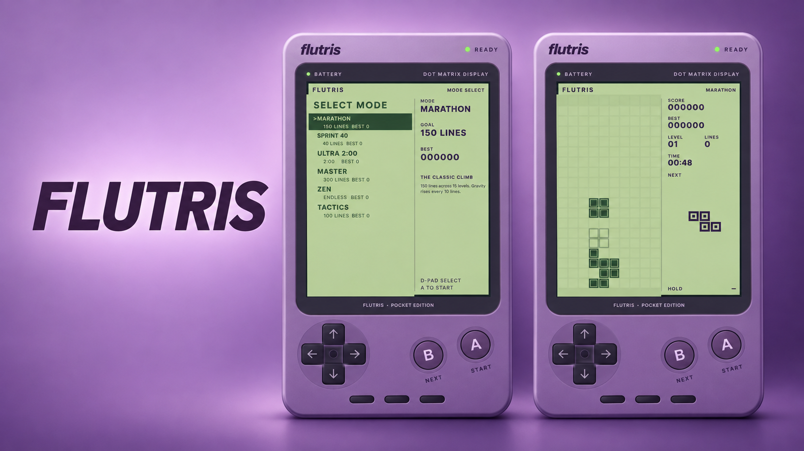
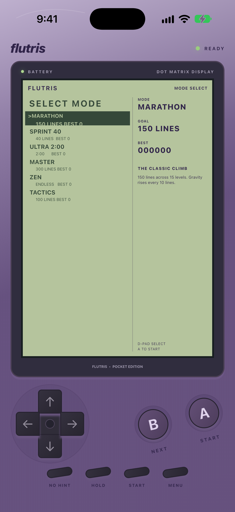
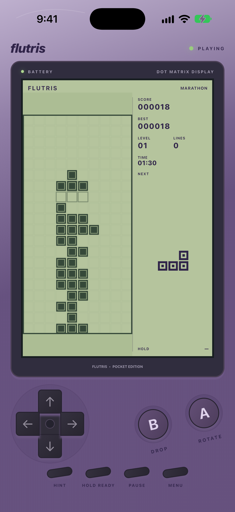
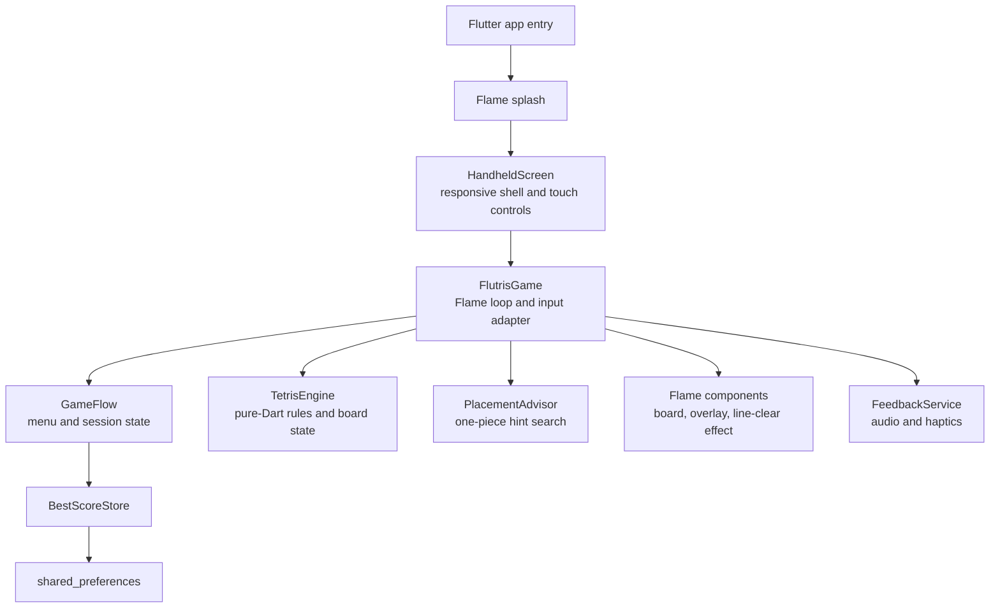

# Flutris

<p align="center">
  
</p>

Flutris is a handheld-inspired falling-block puzzle game built with Flutter and
Flame. A responsive Flutter console shell surrounds a live LCD-style playfield,
with touch and keyboard controls, six game modes, audio, haptic feedback, and
per-mode high scores saved on the device.

<p align="center">
  <a href="https://github.com/WorkWithAfridi/Flutris">Source on GitHub</a>
  &nbsp;·&nbsp; Version 1.0.0
</p>

## iOS simulator screenshots

Captured from the iPhone 18 Pro simulator running iOS 27.2.

<p align="center">
  
  &nbsp;&nbsp;
  
</p>

## Features

- Six selectable modes, each with its own goal and rule configuration.
- 10 × 20 playfield with SRS-style rotation kicks, ghost piece, hold, and a
  seven-bag piece sequence.
- Scoring for drops and line clears, level progression, combos, and mode-specific
  gravity and lock timing.
- Placement hints from a one-piece board evaluator.
- Touch controls in the handheld shell and keyboard controls for desktop and
  simulator play.
- Menu background music, pooled sound effects, and best-effort haptics.
- Per-mode best scores stored locally with `shared_preferences`.
- Edge-to-edge, responsive layout and an animated Flame boot splash.

## Game modes

| Mode | Goal | Rules and scoring |
| --- | --- | --- |
| **Marathon** | Clear 150 lines | Starts at level 1; advances every 10 lines up to level 15. Combo scoring and hints. |
| **Sprint 40** | Clear 40 lines | Fixed at level 5 with a 0.5× score multiplier. |
| **Ultra 2:00** | Score as much as possible in 2 minutes | Fixed at level 5; 1.5× score multiplier and combo scoring. |
| **Master** | Clear 300 lines | 20G instant gravity; displayed M1 through M30; lock delay shortens from 500 ms toward 80 ms. 2× score multiplier. |
| **Zen** | Endless | Relaxed gravity; topping out clears the board and play continues. |
| **Tactics** | Clear 100 lines | Starts at level 3, with a six-piece preview, hints, combo scoring, and a 1.2× multiplier. |

The complete mode configuration and rules are in [`ENGINE.md`](ENGINE.md).

## Controls

### Touch

| Control | In a game | In the mode menu |
| --- | --- | --- |
| D-pad left / right | Move piece | Select previous / next mode |
| D-pad down | Soft drop | Select next mode |
| D-pad up | Hard drop | Select previous mode |
| **A** | Rotate clockwise | Start selected mode / confirm |
| **B** | Hard drop | Advance to the next mode |
| **HINT** | Show or hide placement hint | — |
| **HOLD** | Swap the active piece with the held piece | — |
| **PAUSE / START** | Pause or resume | Start selected mode |
| **MENU** | Save the current best and return to mode select | — |

At an end screen, **A** or **PAUSE / START** restarts the current mode; **B** or
**MENU** returns to mode select. The sound toggle is currently available from
the keyboard only.

### Keyboard

| Action | Keys |
| --- | --- |
| Select mode | ↑ / ↓ |
| Start / confirm / return to menu from end screen | Enter, Space, or Z |
| Move | ← / → or A / D |
| Soft drop | ↓ |
| Hard drop | ↑ or X |
| Rotate clockwise | Space or Z |
| Rotate counter-clockwise | Q |
| Hold piece | C or left Shift |
| Toggle hint | H |
| Pause / resume | P |
| Return to mode menu | Esc |
| Start a new run from an end screen | R |
| Toggle sound and music | M |

Horizontal keyboard movement uses an initial delay followed by repeated movement
while the key is held.

## Architecture

The game separates rules, navigation, rendering, and device-facing services.
The rules engine and placement advisor are plain Dart and do not depend on
Flutter or Flame.



### Runtime layers

- **Flutter shell** — `HandheldScreen` lays out the translucent handheld body,
  LCD display, side stats, and lower controls. It forwards touch actions to the
  game and reads the same game state for the Flutter-rendered stats panel.
- **Flame integration** — `FlutrisGame` owns the `FlameGame` update/render
  lifecycle, keyboard handling, held-key repeat, game flow, engine callbacks,
  and the Flame component tree.
- **Rules engine** — `TetrisEngine` owns the 10 × 20 settled board, active
  piece, collision and rotation, gravity, lock delay, line clears, scores,
  timers, and end conditions. `TetrisSnapshot` provides a read-only state view.
- **Flow controller** — `GameFlow` tracks mode selection and menu, playing,
  paused, victory, game-over, and time-up states. It records per-mode bests and
  notifies the persistence layer when a new record is set.
- **Placement advisor** — `PlacementAdvisor` evaluates legal rotations and
  landing columns on a copied board. It ranks candidate landings using board
  features such as cleared lines, holes, transitions, wells, and surface
  roughness; it does not mutate the live engine.
- **Rendering components** — `BoardComponent` paints the board and pieces;
  `FlowOverlayComponent` paints the in-canvas menu, compact HUD, hints, and end
  overlays; `LineClearEffect` draws line-clear feedback.
- **Device services** — `FeedbackService` handles audio and haptics, while
  `BestScoreStore` persists high scores through Flutter plugin APIs.

### Engine rules

- Seven tetrominoes, a 7-bag randomizer, four rotation states, and SRS-style
  wall kicks.
- Ghost-piece landing preview, configurable next-piece queue, and one hold per
  active piece.
- Default 500 ms lock delay with up to 15 resets from successful moves or
  rotations. Modes can change gravity and lock-delay rules.
- Soft drop scores 1 point per cell; hard drop scores 2 points per cell.
  Line-clear scoring is multiplied by level and mode configuration; enabled
  modes also use combo bonuses.
- Engine callbacks expose state changes, gameplay events, and cleared rows so
  rendering, persistence, audio, and tests can respond without owning the rules.

See [`ENGINE.md`](ENGINE.md) for the engine API, exact scoring, mode presets,
coordinate system, and extension examples. A shorter Flame/UI wiring note is
available in [`lib/game/ENGINE.md`](lib/game/ENGINE.md).

## Audio and haptics

Flutris uses [`flame_audio`](https://pub.dev/packages/flame_audio) for cached
audio assets, pooled sound effects, and the menu background track. One shared
`FeedbackService` serves both Flutter controls and game events. The menu track
plays in mode select and stops while a game is active. The keyboard **M** key
toggles sound effects and menu music.

Sound effects are declared in `lib/feedback/feedback_cue.dart` and mapped from
engine events. They cover menu taps and navigation, movement, rotation, drops,
piece lock, line clears, Tetris clears, combos, level ups, hold, pause, victory,
and game over. Cues may be rate-limited to avoid rapid repeats. Haptics use
Flutter's `HapticFeedback` API; audio or haptic platform failures are ignored so
gameplay can continue.

Audio files live in `assets/audio/` and are registered as a directory in
`pubspec.yaml`.

## High-score storage

`BestScoreStore` stores a separate integer record for each `GameMode` using
`shared_preferences` keys in the form `flutris.best.<mode>`. The game loads
records asynchronously so storage does not block the first frame. Saving is
best effort; if local storage is unavailable, the current session still works
and scores remain in memory for that run. Records are local to the device and
are not synced between devices.

## Project layout

```text
lib/
  main.dart                         App entry and edge-to-edge system UI
  ui/
    splash_screen.dart              Splash-to-game transition
    handheld_screen.dart            Responsive console and touch controls
  game/
    tetris_engine.dart              Pure-Dart board rules and scoring
    tetromino.dart                  Piece geometry and SRS kick data
    piece_bag.dart                  7-bag randomizer
    game_mode.dart                  Six mode configurations
    level_system.dart               Level, gravity, and goal progression
    game_flow.dart                  Menu and session state machine
    placement_advisor.dart          Placement hint evaluator
    flutris_game.dart               Flame loop and input integration
    components/                     Flame board, overlay, and effects
    splash/                         Flame boot animation
  feedback/                         Audio cues and haptic/audio service
  persistence/                      Per-mode best-score store
assets/
  audio/                             Music and sound effects
  branding/                          App icon and README cover artwork
screenshots/                         Mode-select and gameplay captures
test/                                Engine, UI, feedback, and storage tests
ENGINE.md                            Engine API and implementation guide
```

## Dependencies

| Package | Role |
| --- | --- |
| Flutter SDK | App shell, touch UI, system UI, and platform integration |
| [`flame`](https://pub.dev/packages/flame) `^1.38.2` | Game loop, canvas, components, and splash scene |
| [`flame_audio`](https://pub.dev/packages/flame_audio) `^2.12.2` | Background music and pooled audio effects |
| [`shared_preferences`](https://pub.dev/packages/shared_preferences) `^2.5.6` | Local best-score persistence |

`pubspec.yaml` also declares `material_ui` and `cupertino_icons`; the current
application source does not import those packages.

Version constraints for the Dart SDK and dependencies are in
[`pubspec.yaml`](pubspec.yaml). The project uses the application ID
`game.workwithafridi.flutris` on Android, iOS, and macOS.

## Run locally

Install Flutter with a Dart SDK that satisfies the constraint in `pubspec.yaml`,
then from the repository root run:

```sh
flutter pub get
flutter devices
flutter run -d <device-id>
```

To use the default connected device, run `flutter run` without `-d`.

## Analyze and test

```sh
flutter analyze
flutter test
```

Tests cover the rules engine and modes, Flame game wiring, responsive layout,
touch hit targets, audio feedback, navigation, and best-score persistence.
