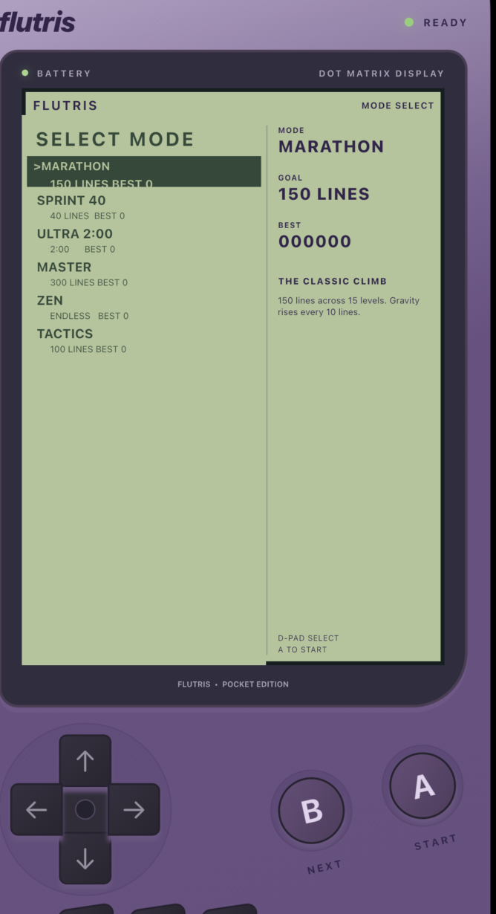
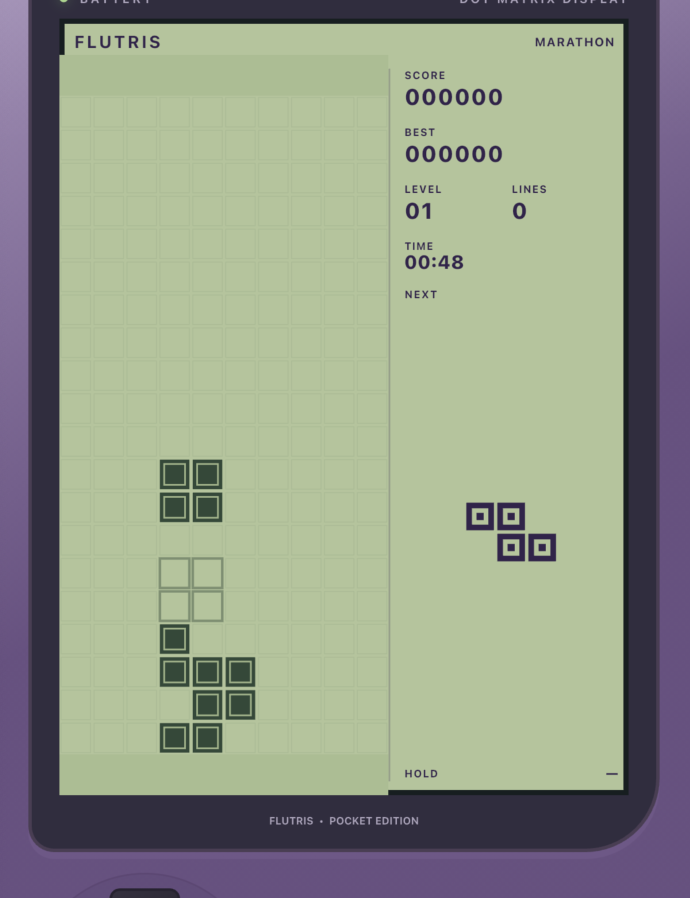

# Flutris

<p align="center">
  
</p>

Flutris is a handheld-inspired falling-block puzzle game built with Flutter and
Flame. It combines a live LCD-style board with touch controls, six game modes,
sound effects and haptic feedback.

## In-app screenshots

<p align="center">
  
  &nbsp;&nbsp;
  
</p>

## Game modes

| Mode | Goal | Style |
| --- | --- | --- |
| Marathon | Clear 150 lines | Classic progression across 15 levels |
| Sprint 40 | Clear 40 lines | Race the clock at a fixed level |
| Ultra 2:00 | Score attack | Set a high score in two minutes |
| Master | Clear 300 lines | 20G gravity with a shrinking lock delay |
| Zen | Endless | Relaxed gravity; top-outs reset the board |
| Tactics | Clear 100 lines | Hints, combos and a deeper next-piece queue |

The engine includes SRS wall kicks, ghost pieces, a seven-bag randomizer,
soft and hard drop scoring, line clears, combos, best scores, hold and
placement hints.

## Controls

| Action | Touch | Keyboard |
| --- | --- | --- |
| Move | D-pad left/right | ←/→ or A/D |
| Soft drop | D-pad down | ↓ |
| Hard drop | D-pad up or B | ↑ or X |
| Rotate clockwise | A | Space or Z |
| Rotate counter-clockwise | — | Q |
| Hold piece | HOLD | C or Shift |
| Hint | HINT | H |
| Pause/resume | PAUSE | P |
| Return to mode menu | MENU | Esc |
| Restart | — | R |
| Toggle sound | — | M |

In the mode menu, use the D-pad to choose a mode and A to start it. B moves to
the next mode.

## Run locally

```sh
flutter pub get
flutter run
```

To choose a device, run `flutter devices`, then `flutter run -d <device-id>`.

## Project structure

- `lib/ui/handheld_screen.dart` — responsive console shell, HUD and touch UI.
- `lib/game/flutris_game.dart` — Flame update loop, controls and game flow.
- `lib/game/tetris_engine.dart` — pure-Dart rules, board state and scoring.
- `lib/game/components/` — board, HUD/menu overlay and line-clear effects.
- `lib/feedback/` — shared sound and haptic feedback.
- `ENGINE.md` — engine rules and public API.

## Checks

```sh
flutter analyze
flutter test
```
